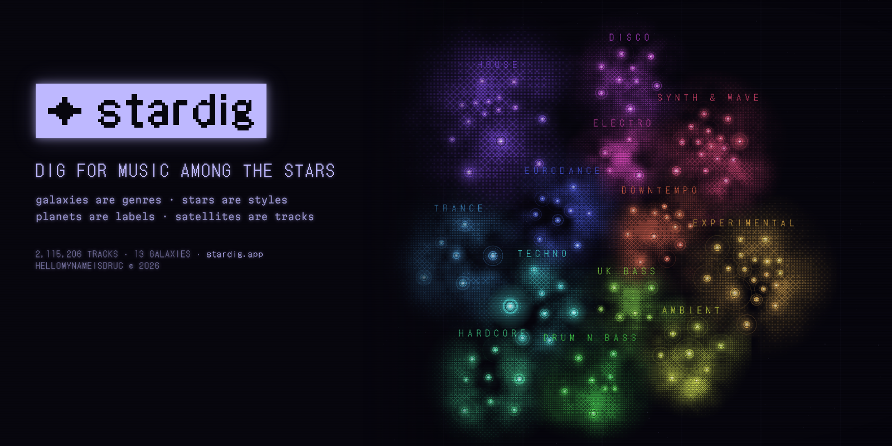

<p align="center">
  <a href="https://stardig.app/"></a>
</p>

<p align="center">
  <a href="https://stardig.app/"></a>
  <a href="https://github.com/hellomynameisdruc/stardig/actions/workflows/deploy.yml"></a>
  
</p>

<p align="center">
  <b>Galaxies are genres · stars are styles · planets are labels · satellites are tracks.</b><br>
  Fly through 2.1 million tracks of electronic music, from whole genres down to a single record, and listen as you go.
</p>

<p align="center">
  
</p>

---

## The universe at a glance

| Galaxies | Stars | Planets | Satellites | Releases | Years |
|:-:|:-:|:-:|:-:|:-:|:-:|
| **13** | **128** | **20,488** | **2,115,206** | **1,143,694** | **1980–2026** |
| genres | styles | labels | tracks | from Discogs | of music |

House · Techno · Disco · Trance · Drum n Bass · Ambient · Downtempo · Experimental · Electro · Synth & Wave · UK Bass · Hardcore · Eurodance

## What is out there

| | |
|---|---|
| 🌌 **Galaxy** | A family of genres: a dithered cloud of its star systems. Galaxies that share many releases sit side by side. |
| ⭐ **Star** | A Discogs style (Deep House, Acid, Dub Techno…). Its size is how many releases the style has, its glow is how alive it is today, and it **pulses at the style's typical tempo**, shedding a shell every bar. |
| 🪐 **Planet** | A label, orbiting its main style. Five kinds: **gas giants** (the biggest labels), **ringed worlds** (15+ years of releases), **cratered** (went quiet before 2001), **ice worlds** (started after 2010) and **terrestrial**. |
| 🛰️ **Satellites** | The label's tracks, older ones closer in. Up to 250 per planet, spread evenly over the label's whole history. |
| ☄️ **Asteroid belt** | Releases with no label or from very small ones, at the edge of each system. |

## Three phosphors, one cosmos

<table>
  <tr>
    <td width="33%"><br><sub><b>Violet</b> — the whole universe</sub></td>
    <td width="33%"><br><sub><b>Green</b> — the Deep House system</sub></td>
    <td width="33%"><br><sub><b>Amber</b> — the Rush Hour planet</sub></td>
  </tr>
</table>

## What you can do

- **Zoom** with the wheel or two fingers: galaxies → systems → orbits → signals.
- **Open any object**: a dossier with its numbers, activity per year, neighbours and tracks.
- **Play**: tracks play in the embedded YouTube player.
- **Autopilot**: when a track ends, the ship flies on to the nearest track you haven't heard yet.
- **Odysseys**: start one from a star, then pick where to go (any other system). It visits 10 planets in 5 systems, entering and leaving each through "gate" labels that face the next system, with 20+ fresh tracks and its own shareable link.
- **Hitchhike the system**: on a star, thumb a ride round ten of its labels (from the big inner planets out to the edge), 42 tracks, a different ride every time.
- **Time warp**: on a planet, the label's story in order, one track a year from its first release to its last; defunct labels end on their last transmission.
- **Solaris station**: on a planet, park a radio station in its orbit: an endless radio of that label, and the player counts how many of its tracks you've heard.
- **Wormhole**: a jump to a random point in the cosmos. The signal scope in the dossier rides the jump with you.
- **Beacons**: mark the tracks you love. The **flight log** keeps your listening history. Both stay in your browser.
- **Share**: the address bar always holds a link to the current track or odyssey.


### Keyboard

| Key | |
|:-:|---|
| <kbd>/</kbd> | search by galaxy, style, label or artist |
| <kbd>Space</kbd> | pause / play |
| <kbd>N</kbd> | next nearby track |
| <kbd>L</kbd> | set a beacon |
| <kbd>W</kbd> | wormhole |
| <kbd>H</kbd> | back to the full sector |
| <kbd>Esc</kbd> | back |

### On a phone

The map works with one and two fingers. While music plays, the player becomes a sheet along the bottom of the screen and the map gets the rest.

<br clear="right">

## Where the data comes from

The catalogue is the monthly **[Discogs data dump](https://data.discogs.com/)**, released under **CC0**, where releases already carry links to their videos.
stardig only embeds the official YouTube player. **Nothing is ever downloaded from YouTube**, and the player is always visible while it plays.

<details>
<summary><b>How the map is made</b></summary>

<br>

1. **Parse.** Discogs serves its dumps only to regular browsers, so the ~11 GB file is processed right in the browser: `pipeline/browser_parse.js` streams it on the Discogs page and saves `sectors.jsonl.gz`, which holds every release of every galaxy defined in `pipeline/sectors.json`.
2. **Merge.** `pipeline/catalog.py` folds the editions of a release into one entry and keeps those with videos.
3. **Build.** `pipeline/build_map.py` turns the catalogue into the map: stars and their links, galaxies packed so that neighbours face each other, planets on orbits, satellites, and asteroid belts. The build is deterministic.
4. **Publish.** The full map lives on the `data` branch. Every push to `main` builds the site and deploys it to GitHub Pages.

</details>

<details>
<summary><b>Under the hood</b></summary>

<br>

Plain TypeScript, no framework, built with Vite and drawn on two canvases:

- The **static layer** holds the grid, nebulae and belts. It is repainted only when the camera settles, and is slid and scaled by CSS in between.
- The **live layer** holds everything that moves, plus all names, and is redrawn every frame.

```
web/src/
  core/      types, small helpers, DOM access
  model/     pure logic: galaxy (planet types, star classes, tempo), motion (orbits), routes
  data/      fetching the map and each star's tracks
  store/     the visitor's own data: beacons, flight log, prefs
  cloud/     accounts and live data (Supabase): pilots, COMMS, fleets, the synced logbook
  app/       shared state, actions (select, play, next, plot an odyssey, wormhole), and the
             ports: what actions ask of the UI, filled in by the UI (so nothing imports in a circle)
  render/    camera, palette, layers, pulsars, planets, satellites, route line, picking
  ui/        dossier, player, odyssey panel, log & beacons, COMMS, pilot card, the message rail,
             overlays, search, input, effects
  styles/    tokens (type sizes, colours, layers), then one file per part of the terminal
web/test/    Vitest
web/e2e/     two browsers against a stand-in for Supabase: fleets, tune in, fleet chat
pipeline/    Python: parse → catalogue → map, with pytest
supabase/    the database: tables, rules, live channels (schema.sql)
```

The interface speaks in one place: the **message rail** along the top of the map (a mode in progress,
on air, ✓ done, ! trouble), or the top of an open card. Errors in a form show right under it.

Every push runs types, lint (ESLint, ruff) and tests for the site and the pipeline. The site is deployed only if they pass.

</details>

## Next on the flight plan

- [ ] Accounts: beacons and flight log synced between devices, public beacon collections
- [ ] Search by track title
- [ ] Live-video checks, so dead satellites go dark
- [x] New galaxies: Downtempo, Experimental, Electro, Synth & Wave, UK Bass, Hardcore, Eurodance
- [ ] A fresh map every month, straight from the new Discogs dump
- [ ] Its own domain

---

<p align="center">
  <sub>© 2026 <b>hellomynameisdruc</b>. All rights reserved. See <a href="LICENSE">LICENSE</a>.<br>
  Catalogue data © Discogs contributors, released under CC0. Videos are streamed from YouTube and belong to their owners.</sub>
</p>
